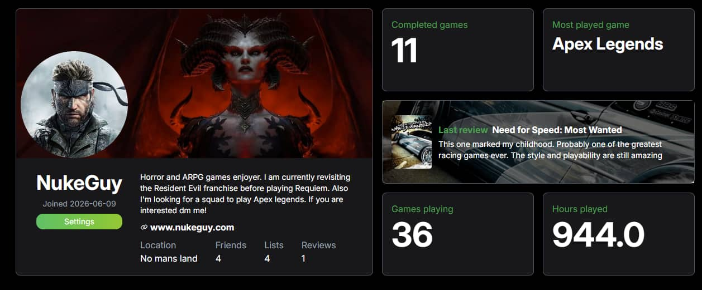
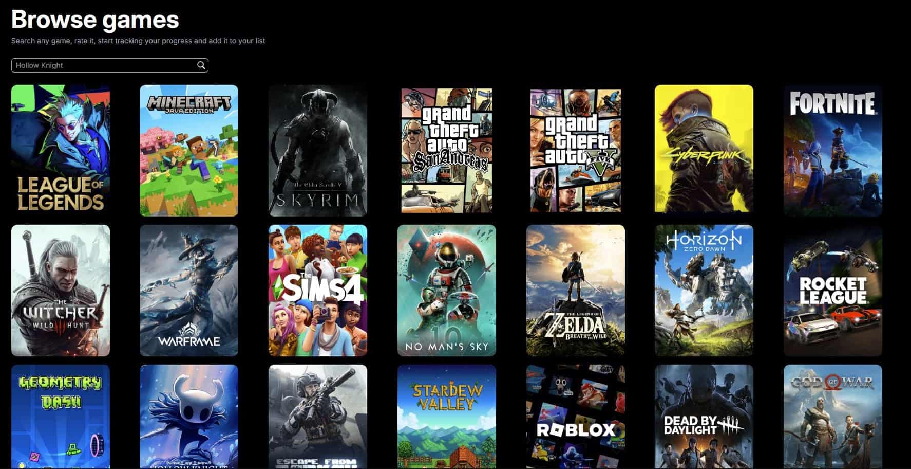
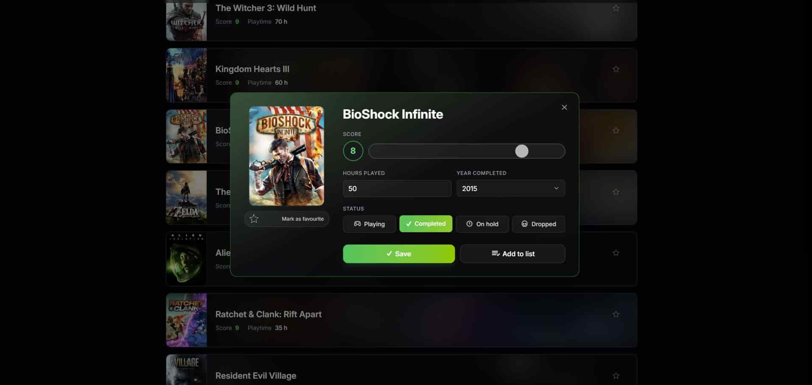
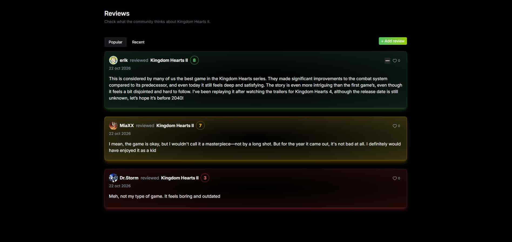
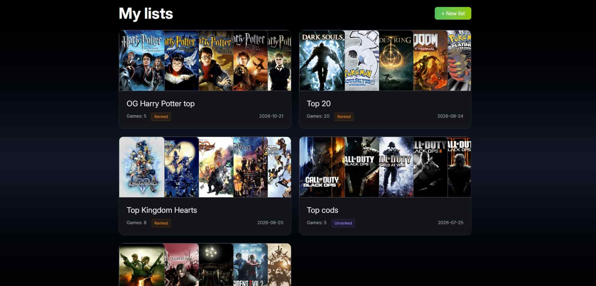
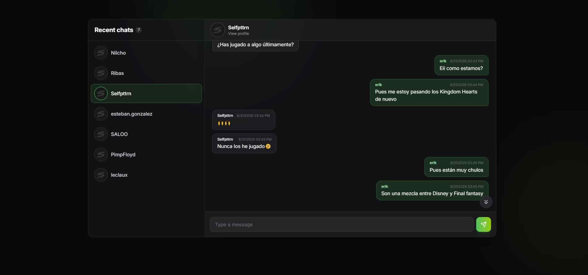

  <a href="https://statrix.app">
    <picture>
      <source media="(prefers-color-scheme: dark)" srcset="public/logos/st2_white.png">
      
    </picture>
  </a>

<h3 align="center">Your gaming journey, all in one place.</h3>

  Track every game you play, share your opinions, build lists and connect with friends who love the same games as you.

  <a href="https://statrix.app"><strong>🌐 Visit statrix.app →</strong></a>

---

## 🎮 What is Statrix?

Statrix is a home for gamers. It is where you keep the story of every game you have played, are playing, or plan to play next, and share it with others.

Whether you finish a game a week or are still working through a backlog from ten years ago, Statrix gives you a profile that shows who you are as a player.

---

## ✨ Features

### 👤 A profile that shows who you are as a player
Show off your gaming identity with a custom avatar, banner and bio. Your profile shows your stats at a glance: completed games, games in progress, hours played, your most played game and your latest review.

### 🔍 Explore a huge game database
Search and browse thousands of games, from the latest releases to classics you grew up with. Each game has its own page with covers, details and what the community thinks about it.

### ⭐ Rate, review and favorite
Give every game the score it deserves, write a review and mark your all-time favorites. You can also read and like reviews from other players.

  
  

### 📋 Create your own lists
Make lists for anything: your backlog, your top 10 RPGs, games to play with friends. Drag and drop to put them in the order you want, then share them.

### 🕹️ Import your Steam library
Connect your Steam account and bring in your games and hours played in just a few clicks. No need to add everything by hand.

### 👥 Friends and real-time chat
Add friends, follow what they are playing and talk to them in real time without leaving Statrix.

---

## 🚀 Get started

1. Go to **[statrix.app](https://statrix.app)**.
2. Sign up with your email or Google account.
3. Add your first games, or import them from Steam.
4. Invite your friends and start sharing your journey.

---

  Game data provided by <a href="https://www.igdb.com/">IGDB</a>. 
  Made with ❤️ by <a href="https://github.com/ErikColacios">Erik Colacios</a>

